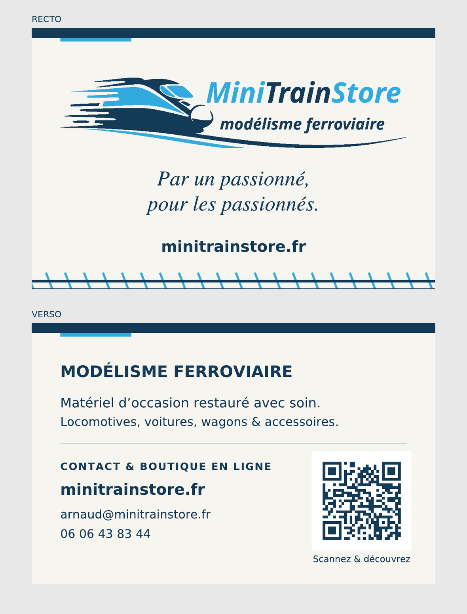

# Mini Train Store — Carte de visite

Présenter la boutique et transmettre ses coordonnées, lors de rencontres, salons ou échanges.

## Fichiers

- [PDF d’impression recto verso](minitrainstore-impression.pdf) : format fini 85 × 55 mm, fond perdu de 3 mm sur chaque côté ; pages de 91 × 61 mm et TrimBox au format fini.
- SVG vectoriels avec textes en tracés : [recto](minitrainstore-recto.svg) et [verso](minitrainstore-verso.svg).
- [Sources avec textes éditables](sources-editables/) : polices DejaVu Sans et Nimbus Roman Italic.
- [Kit complet ZIP](minitrainstore-kit-carte.zip).
- [Consignes d’impression](LIRE-AVANT-IMPRESSION.txt).
- [Autre version](../cartes-expedition/).

Imprimer à 100 %, sans ajustement automatique. Confirmer le profil couleur avec l’imprimeur : couleurs RVB, export non certifié PDF/X. Suggestion : papier mat 300 à 350 g/m².

Le QR code pointe directement vers https://www.minitrainstore.fr/. Logo vectorisé depuis le PNG publié sur le site. Coordonnées reprises de la boutique au 17 octobre 2026.
