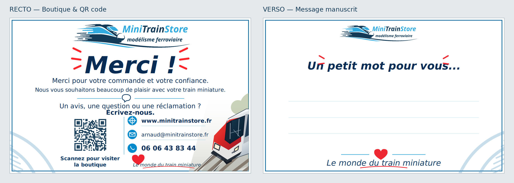

# Mini Train Store — Carte de remerciement pour les expéditions

Carte recto-verso à glisser dans les colis, en conservant le verso largement libre pour ajouter un message manuscrit.



## Design

- **Recto** : logo d'origine MiniTrainStore, grand « Merci ! », remerciement concis **en un paragraphe de deux lignes**, invitation à nous écrire pour un avis, une question ou une réclamation, **QR code** vers https://www.minitrainstore.fr/, URL, e-mail (`arnaud@minitrainstore.fr`) et téléphone (`06 06 43 83 44`). Locomotive photographique discrète en JPEG dans un SVG hybride. Le motif de rails du recto et la signature inférieure ont été supprimés pour alléger la carte ; ils restent sur le verso.
- **Verso** : petit logo, « Un petit mot pour vous… », **grande zone blanche** avec trois lignes très discrètes pour écrire au stylo, signature et motif de rails.
- La [carte de visite](../cartes-de-visite/) reste inchangée.

## Fichiers

- [SVG du recto](minitrainstore-recto.svg) et [SVG du verso](minitrainstore-verso.svg) : **hybrides** : textes, logo, QR code et éléments de mise en page vectoriels ; train en JPEG lié pour le recto. Les textes restent éditables.
- [SVG recto autonome](minitrainstore-recto-standalone.svg) : même composition avec le JPEG **intégré en base64**, pour partager/imprimer sans dépendance externe.
- [Asset photo du train](assets/train-recto.jpg) : JPEG optimisé avec fondu blanc, éditable indépendamment.
- [Sources éditables](sources-editables/) : copies éditables des SVG destinées aux retouches.
- **[Planche A4 recto-verso, 8 cartes par face](minitrainstore-planche-A4.pdf)** : 2 pages A4 portrait (2 colonnes × 4 rangées) avec fonds perdus, traits de coupe et rectos/versos alignés géométriquement. [Aperçu](minitrainstore-planche-A4-apercu.png).
- [PDF d'impression recto-verso](minitrainstore-impression.pdf) : 2 pages, format fini **85 × 55 mm**, fond perdu de **3 mm** de chaque côté et TrimBox au format fini.
- [Aperçu recto-verso](minitrainstore-apercu.png).
- [Kit complet ZIP](minitrainstore-kit-carte.zip).
- [Consignes d'impression](LIRE-AVANT-IMPRESSION.txt).

**Polices** : texte courant en DejaVu Sans ; titres manuscrits en Z003 avec une police de secours générique. Les SVG restent éditables, mais leur rendu typographique peut varier selon les polices installées. Pour déplacer le train, ajuster sa balise `<image>` sans toucher au QR vectoriel. Le PDF est destiné à garantir le rendu du tirage ; les polices requises sont installées dans le workflow de génération.

**Écriture** : papier mat non couché conseillé (300 à 350 g/m²), sans pelliculage ni vernis au verso. Faire un essai avec le stylo utilisé en boutique.

## Impression de la planche A4

Imprimer `minitrainstore-planche-A4.pdf` **à 100 % / taille réelle**, sur **papier A4 portrait**, en **recto-verso, retournement sur les bords longs**, sans option « ajuster à la page ». Page 1 = huit rectos ; page 2 = huit versos. Couper sur les **repères de découpe** (chaque carte finie mesure 85 × 55 mm). Les fonds perdus occupent 3 mm tout autour.

Les deux faces utilisent exactement la même grille centrée, mais les imprimantes domestiques peuvent introduire un décalage entre les faces. **Faire d'abord un test sur papier ordinaire** pour confirmer le retournement, le sens et l'alignement avant un tirage sur papier épais.

## Reproduire les exports

```sh
python -m pip install cairosvg pypdf pillow
python scripts/generate_shipping_card.py
```

Sous Debian/Ubuntu, installer également `fonts-dejavu-core` et `fonts-urw-base35` pour conserver les mêmes polices que l'export CI. La [GitHub Action](../../.github/workflows/shipping-card-assets.yml) régénère les PDF (carte et planche A4), les aperçus PNG et le ZIP après une modification des SVG.

Les coordonnées reprennent celles publiées par la boutique en octobre 2026. Le QR code pointe directement vers l'URL officielle, sans service de redirection.
